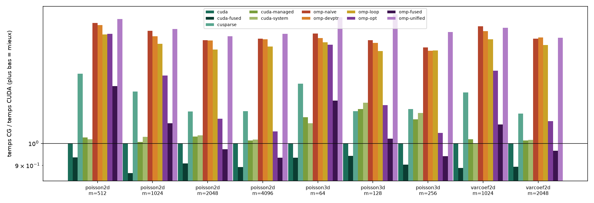
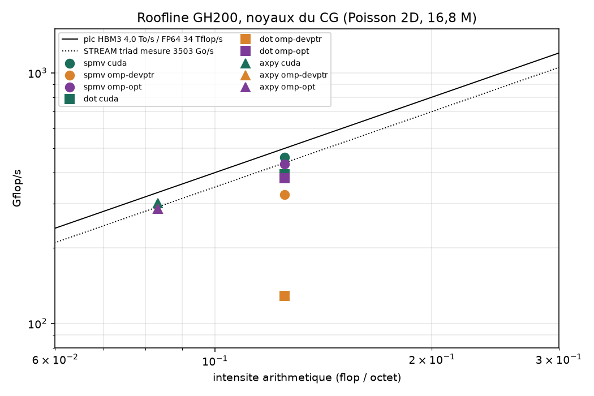

# CUDA contre OpenMP target sur un gradient conjugué (GH200, ROMEO)

Ce projet mesure, sur un même GPU NVIDIA GH200 du supercalculateur ROMEO, la performance d'un gradient conjugué préconditionné (PCG Jacobi) sur matrice CSR écrit de neuf façons : quatre en CUDA et cinq en OpenMP target. Il le fait noyau par noyau (SpMV, produit scalaire, axpy) et sur le solveur complet. Il vient d'une question posée en entretien chez EDF R&D (code_saturne) : *à quel point OpenMP offload rattrape-t-il CUDA, et sur quelles opérations ?*

Les résultats et l'analyse sont dans [`NOTE.md`](NOTE.md), les tableaux dans [`results/summary.md`](results/summary.md).



| CG complet, grands cas (Poisson 2D 4096², 3D 256³, coefficient variable 2048²) | Temps / CUDA à la main |
|---|---|
| OpenMP « par défaut » (`omp-naive`, `-devptr`, `-loop`, `-unified`) | 1,56 à 1,71× |
| OpenMP avec `num_teams` et `thread_limit` (`omp-opt`) | 1,05 à 1,11× |
| OpenMP avec ces clauses et la fusion (`omp-fused`) | **0,93 à 0,96×** |
| CUDA avec fusion (`cuda-fused`) | 0,89 à 0,90× |
| cuSPARSE + cuBLAS | 1,15 à 1,18× |



## Ce que fait le code

| Fichier | Rôle |
|---|---|
| `src/common.h` | Matrices CSR (Poisson 2D 5 points, Poisson 3D 7 points, Poisson 2D à coefficient variable avec un contraste de 10³), PCG Jacobi, harnais de mesure, sortie CSV. **Commun à toutes les versions** : seules les opérations sur le GPU changent. |
| `src/cg_cuda.cu` | Backend CUDA : noyaux écrits à la main (SpMV un thread par ligne, produit scalaire avec réduction par warp `__shfl_down_sync`, puis mémoire partagée, puis une `atomicAdd` par bloc), variante cuSPARSE/cuBLAS, et modes mémoire `cudaMalloc`, `cudaMallocManaged` et `malloc` système (accès direct du GPU à la mémoire du CPU par NVLink-C2C). Contient aussi un mini-STREAM. |
| `src/cg_omp.cpp` | Backend OpenMP target. Les corps de boucle sont identiques dans toutes les variantes, seules les directives changent. |
| `analysis/analyse.py` | Médianes, contrôle des itérations, tableaux et figures. |
| `slurm/bench.slurm` | Job reproductible : 9 cas, 11 versions, 5 répétitions, plus un balayage de `thread_limit`. |

### Les versions

| Version | Idée |
|---|---|
| `cuda` | Noyaux à la main, données en HBM (`cudaMalloc`). Référence. |
| `cuda-fused` | `cuda` avec fusion de noyaux : mise à jour de x et r avec r·r en un seul noyau, Jacobi avec r·z en un autre. On passe de 8 à 5 lancements par itération. |
| `cusparse` | `cusparseSpMV` (CSR, algorithme par défaut) avec `cublasDdot`/`cublasDaxpy`. Référence « vendeur ». |
| `cuda-managed` | Mêmes noyaux, `cudaMallocManaged` : les pages migrent vers la HBM au premier accès du GPU. |
| `cuda-system` | Mêmes noyaux, simple `malloc()`. Sur GH200, le GPU accède à la mémoire du CPU (LPDDR5X) grâce à l'ATS. |
| `omp-naive` | Code « utilisateur » : `target enter data` une fois, puis `target teams distribute parallel for`. À chaque lancement, le runtime cherche l'adresse device de chaque pointeur. |
| `omp-devptr` | `omp_target_alloc` et `is_device_ptr` : plus de recherche dans la table de correspondance. |
| `omp-loop` | `omp-devptr` avec `target teams loop`, la construction conseillée par NVHPC. |
| `omp-opt` | `omp-devptr` avec `num_teams` et `thread_limit` explicites (découpage façon CUDA, balayé de 64 à 1024). |
| `omp-fused` | `omp-opt` avec la même fusion que `cuda-fused`. |
| `omp-unified` | Compilé avec `-gpu=mem:unified` : `malloc()` simple, sans aucune directive de données. |

## Méthode

- **Matériel** : un GPU GH200 (H100 96 Go HBM3, pic théorique de 4,0 To/s) sur un nœud `armgpu` de ROMEO. Le détail exact du nœud, du pilote et des compilateurs est dans `results/env_<job>.txt`. Les chiffres cités viennent du job 827121 ; le job 826985, lancé avant l'ajout de la fusion, donne les mêmes temps à 2 % près.
- **Compilateurs** : NVHPC 24.11, avec `nvcc` pour CUDA et `nvc++ -mp=gpu -gpu=cc90` pour OpenMP. Options dans le `Makefile`.
- **Problème** : `b = A·1` et `x0 = 0`, donc la solution exacte est connue. Arrêt quand `‖r‖/‖b‖ < 1e-8`. Après chaque résolution, l'hôte recalcule indépendamment le vrai résidu et l'erreur.
- **Justesse** : le nombre d'itérations doit être le même pour toutes les versions. Seul l'ordre des additions dans les produits scalaires diffère, ce qui peut décaler d'une itération ; c'est signalé dans `summary.md`.
- **Mesure** : un échauffement (qui déclenche aussi les migrations de pages), puis 5 répétitions, dont on garde la médiane. Pour les noyaux, on fait 50 appels par mesure et on divise le temps total par 50.
- **Bande passante effective** : octets d'un modèle idéal divisés par le temps. SpMV = `12·nnz + 4·(n+1) + 16·n`, dot = `16·n`, axpy = `24·n`. Le résultat est rapporté au pic théorique et au STREAM triad mesuré.

## Reproduire

```bash
ssh romeo
cd ~/cg-openmp-vs-cuda
srun -p instant -A r260073 --constraint=armgpu --gres=gpu:1 --mem=32G -c16 -t 00:15:00 \
     bash -lc "module load nvhpc/nvhpc-nompi/24.11 && make"
sbatch slurm/bench.slurm
```

Puis, sur la machine locale, après avoir copié `results/` :

```bash
.venv/bin/python analysis/analyse.py results/raw_<job>.csv results/sweep_<job>.csv
```

## Limites

- **Pas de LLVM/clang sur ROMEO** (vérifié dans les modules le 16/11/2026). Les optimisations du runtime LLVM étudiées par Sala et al. (IWOMP 2025) ne sont donc **pas** testées : tout le côté OpenMP repose sur NVHPC. Ce papier est derrière une connexion Springer, et je ne l'ai pas lu en entier.
- **Un seul GPU et un seul nœud** : pas de multi-GPU ni de MPI.
- **CSR scalaire uniquement**, avec un thread par ligne. C'est le bon choix pour 5 à 7 non-zéros par ligne, mais pas pour des matrices à lignes longues, où un warp par ligne serait meilleur.
- **Modèle d'octets idéal** : sur les petites tailles, les données tiennent dans le cache L2 (50 Mo), et la « bande passante effective » peut alors dépasser le pic HBM. Ce n'est pas une erreur, mais ces points ne disent rien de la mémoire.
- Le produit scalaire renvoie sa valeur à l'hôte à chaque appel, dans toutes les versions : c'est la synchronisation naturelle du CG.
